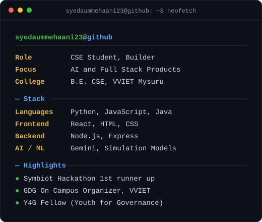

## Hi there 👋

# Syeda Umme Haani

### Software Engineer | AI, Data and Cloud | GDG On Campus Organizer

*Final-year CS student building user-focused products with AI, data and cloud. Open to full-time roles from April 2027.*

---

<table>
<tr>
<td width="50%" valign="top">

</td>
<td width="50%" valign="top">

### 🧑‍💻 Who am I?

- 🎓 B.E. Computer Science and Engineering (2023-2027), **VVIET, Mysuru**, CGPA **9.03/10**
- 💻 Full-stack and AI builder: React, Node.js, Python, Firebase, AWS
- 🏛️ **Y4G Fellow** (Youth for Governance), researching civic problems for Mysuru
- 🌱 **GDG On Campus Organizer**: 20+ events for 800+ students
- 🎤 Master of Ceremonies, **GraVVIETy** tech fest (2000+ participants)
- 🔬 Granted **Design Patent** and a **published research paper**

> *"From the dataset to the dashboard."*

</td>
</tr>
</table>

---

## 🏅 Achievements

- 🥈 **2nd Runner-Up**: VVCE SymbIoT (SaviorNet)
- 📄 **Published Research Paper**: IRJMETS, Volume 08, Issue 10 (2026) · [DOI: 10.56726/IRJMETS103815](https://www.doi.org/10.56726/IRJMETS103815)
- 🥇 **Best Intern Award**: Infosys Mysore DC
- 🏆 **Grand Finalist**: iQOO Hackathon (LifeLink Grid)
- 🥈 **Runner-Up**: Google TechSprint Hackathon (GDG x Hack2skill)
- ⭐ **Top 6 of 200+ teams**: IoTopia (BusBuddy)
- 🌍 **Regional Winner**: Wipro Sustainability Education Programme
- 🇮🇳 **National-Level Winner**: Science Talent Search Examination
- 🎓 Google Developer Groups On Campus: Tier 1 and Green House win, 2025-26

---

## 📄 Research Publication

**Journal:** International Research Journal of Modernization in Engineering Technology and Science (IRJMETS)
**Volume 08, Issue 10 (2026)** · **Certificate Ref:** IRJMETS/Certificate/Volume 08/Issue 10/81000082573
**DOI:** [10.56726/IRJMETS103815](https://www.doi.org/10.56726/IRJMETS103815)

> TODO: add your paper title here in bold, and a one-line summary of what it covers.

---

## ⚡ Tech Stack

<table>
<tr>
<td width="50%" valign="top">

### 💻 Languages

### 🎨 Frontend

### ⚙️ Backend

</td>
<td width="50%" valign="top">

### 🗄️ Databases

### ☁️ Cloud and DevOps

### 🤖 AI and Data
`Computer Vision` `YOLOv8` `OpenCV` `Machine Learning` `Generative AI` `Power BI` `Tableau`

</td>
</tr>
</table>

---

## 💼 Featured Projects

<table>
<tr>
<td width="50%" valign="top">

### 🚑 [LifeLink Grid](https://github.com/SyedaUmmeHaani23/lifelink-grid)
Emergency dispatch that routes patients to the *right* hospital, not just the nearest, using beds, blood, oxygen, ambulances, urgency and insurance eligibility.

`React` `AWS Lambda` `DynamoDB` `Bedrock`

- ✅ Grand Finalist, iQOO Hackathon
- ✅ Bedrock-based triage and Leaflet map tracking

</td>
<td width="50%" valign="top">

### 🥥 AI Coconut Harvesting System
A vision pipeline for autonomous coconut harvesting, from image capture to inference to actuation.

`Python` `YOLOv8` `OpenCV`

- ✅ Design Patent granted
- ✅ 92% detection accuracy with YOLOv8

</td>
</tr>
<tr>
<td width="50%" valign="top">

### 🎓 KnowZone
Campus super-app with four modules: mentorship, resources, real-time bus tracking, and lost and found.

`React` `Flutter` `Firebase` `Google Maps API`

- ✅ Serves 500+ students
- ✅ GDG selection project

</td>
<td width="50%" valign="top">

### 🔍 [Catchblock](https://github.com/SyedaUmmeHaani23/Catchblock)
Repository health analyzer. Scan a GitHub URL or folder and get a 0-100 health score with plain-English fixes.

`Web App` `Backend API` `GitHub`

- ✅ Commit-history insights and safe fix previews
- ✅ Built for students and hackathon teams

</td>
</tr>
<tr>
<td width="50%" valign="top">

### 🆘 SaviorNet
Real-time disaster coordination that routes rescue teams across multiple concurrent incidents.

`Firebase` `Google Maps API`

- ✅ 2nd Runner-Up, VVCE SymbIoT

</td>
<td width="50%" valign="top">

### 🚌 [BusBuddy](https://github.com/SyedaUmmeHaani23/BusBuddy)
IoT bus tracking with live location streams, alerts and route optimization.

`Firebase` `IoT` `JavaScript`

- ✅ Top 6 of 200+ teams, IoTopia

</td>
</tr>
</table>

---

## 🚀 Experience

| Role | Organization | When |
|---|---|---|
| Intern | PepsiCo (Remote) | Sep-Oct 2026 |
| Power BI Intern | Microsoft Elevate AICTE | 2026 |
| Data Analytics Virtual Intern | Deloitte (Forage) | 2025 |
| Software Engineering Intern | Infosys Springboard 5.0 | Nov 2024-Feb 2025 |
| GDG On Campus Organizer | GDG, VVIET | 2023-Present |
| Y4G Fellow | Youth for Governance (GRAAM and Hanns Seidel Foundation) | 2026-Present |

---

## 📈 GitHub Stats

---

### 🤝 Let's build something together

